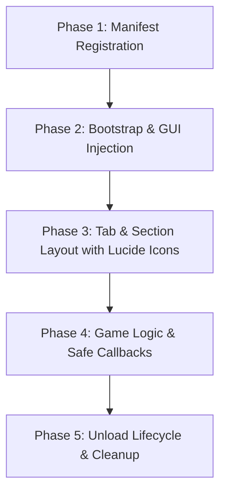

# GousseUI Library & Development Phases Guide

GousseUI is a lightweight, authentic desktop utility UI Library engineered for Roblox execution environments and the Gousse Script Hub ecosystem.

---

## 1. Core Architecture & Theme System

GousseUI v2.1.0 adopts an authentic modern tactical gaming aesthetic: deep obsidian slate surfaces, soft perimeter borders, refined 2px top emerald accent line, high-contrast BuilderSans typography, and fully responsive mobile architecture.

| Token | RGB Value | Hex | Usage |
| :--- | :--- | :--- | :--- |
| `Background` | `11, 14, 20` | `#0B0E14` | Deep obsidian slate outer window |
| `Sidebar` | `15, 19, 27` | `#0F131B` | Navigation sidebar & elevated sub-containers |
| `Surface` | `19, 25, 35` | `#131923` | Interactive control rows & cards |
| `SurfaceHover` | `26, 35, 50` | `#1A2332` | Interactive hover & focus state |
| `Border` | `30, 41, 59` | `#1E293B` | Soft slate perimeter border & dividers |
| `BorderLight` | `51, 65, 85` | `#334155` | Subtle separators |
| `WindowOutline`| `16, 185, 129` | `#10B981` | Emerald accent outline & top accent bar |
| `Accent` | `16, 185, 129` | `#10B981` | Modern vibrant emerald for active states & FAB |
| `Blue` | `56, 189, 248` | `#38BDF8` | Sky cyan for semantic info & numeric values |
| `Warning` | `245, 158, 11` | `#F59E0B` | Muted amber warning toasts |
| `Danger` | `244, 63, 94` | `#F43F5E` | Destructive/unload actions & error toasts |
| `TextPrimary`| `248, 250, 252` | `#F8FAFC` | Crisp white titles and active labels |
| `TextSecondary`| `148, 163, 184`| `#94A3B8`| Slate-400 high-contrast subtitles (WCAG AAA) |
| `TextMuted` | `100, 116, 139`| `#64748B`| Small section headers & placeholders |

### Safe Parenting Invariant
To prevent game-level detection, all GUI instances must resolve parents using:
```luau
local function GetSafeGuiParent(): Instance
    if gethui then
        local ok, hui = pcall(gethui)
        if ok and hui then return hui end
    end
    local okCore, cg = pcall(function() return game:GetService("CoreGui") end)
    if okCore and cg then return cg end
    return game.Players.LocalPlayer:WaitForChild("PlayerGui")
end
```

---

## 2. Lucide Icons Engine (No Emoticons Rule)

> [!IMPORTANT]
> **Strict Invariant**: Do **not** use emojis or emoticons (e.g. `⚡`, `🎯`, `👁`, `🛠`, `⚙`) in UI tabs, buttons, or section headers. Always use authentic **Lucide icon names** resolved through `icons.luau` or `GousseUI:GetIcon(name)`.

### Popular Icon Names
- **Movement**: `"gauge"`, `"move"`, `"navigation"`, `"zap"`, `"activity"`
- **Visuals**: `"eye"`, `"eye-off"`, `"camera"`, `"maximize-2"`
- **Combat**: `"crosshair"`, `"target"`, `"flame"`, `"shield"`
- **Utility**: `"wrench"`, `"sliders"`, `"terminal"`, `"server"`, `"refresh-cw"`, `"copy"`
- **Player**: `"user"`, `"users"`, `"user-check"`
- **General / Settings**: `"settings"`, `"info"`, `"power"`, `"trash-2"`

### Icon Resolution Example
```luau
local iconAssetId = GousseUI:GetIcon("crosshair") -- Returns "rbxassetid://10709818534"
```
When creating tabs in `GousseUI`, pass the icon name directly:
```luau
local CombatTab = Window:CreateTab({ Name = "Combat", Icon = "crosshair" })
local MovementTab = Window:CreateTab({ Name = "Movement", Icon = "gauge" })
local VisualsTab = Window:CreateTab({ Name = "Visuals", Icon = "eye" })
local UtilityTab = Window:CreateTab({ Name = "Utility", Icon = "wrench" })
local AboutTab = Window:CreateTab({ Name = "About", Icon = "info" })
```

---

## 3. API Reference & Component Cheatsheet

### 3.1 Window Creation
```luau
local Window = GousseUI:CreateWindow({
    Title = "Gousse Hub",
    SubTitle = "Universal • Authentic Desktop Edition",
    Keybind = Enum.KeyCode.RightControl,
    Size = UDim2.new(0, 650, 0, 420)
})
```
- **Methods**:
  - `Window:Toggle(state: boolean?)`: Toggle or set visibility.
  - `Window:Destroy()`: Safely unloads the ScreenGui.
  - `Window:CreateTab({ Name: string, Icon: string? })`: Instantiates a navigation tab.

### 3.2 Section Divider
Creates an understated uppercase category label with a subtle 1px divider line:
```luau
UtilityTab:CreateSection("Player Teleportation")
UtilityTab:CreateSection("Server & Session")
```

### 3.3 Interactive Controls

#### Button Row (Primary, Secondary, or Danger)
Buttons have distinct visual variants instead of generic blue cards:
- `"primary"`: Subtle green highlight for focal actions (e.g., Teleport).
- `"secondary"`: Restrained dark utility button with slate border for standard actions.
- `"danger"`: Muted red highlight for destructive or unload actions.

```luau
-- Primary action button
UtilityTab:CreateButton({
    Name = "Teleport to Player",
    SubTitle = "Translate HumanoidRootPart CFrame +3 studs above target",
    ButtonText = "Teleport",
    Variant = "primary",
    Callback = function()
        -- teleport logic
    end
})

-- Restrained secondary utility button
UtilityTab:CreateButton({
    Name = "Rejoin Current Server",
    SubTitle = "Reconnect client to current place instance",
    ButtonText = "Rejoin",
    Variant = "secondary",
    Callback = function()
        -- rejoin logic
    end
})

-- Destructive action
SettingsTab:CreateButton({
    Name = "Unload Module",
    SubTitle = "Restore state, disconnect connections and remove UI",
    ButtonText = "Unload",
    Variant = "danger",
    Callback = function()
        -- unload logic
    end
})
```

#### Toggle Row
Features an aligned switch toggle on the right. Turns green (`#67D879`) **only** when active.
```luau
local AntiAfkToggle = UtilityTab:CreateToggle({
    Name = "Anti-AFK Watchdog",
    SubTitle = "Simulate controller events on idle to bypass 20-min kick",
    Default = false,
    Callback = function(enabled: boolean)
        print("Anti-AFK state:", enabled)
    end
})
-- Methods: AntiAfkToggle.Set(true), AntiAfkToggle.Get()
```

#### Slider Row
Compact row featuring real-time value output in code font (`#67D879`) and a thin 4px track:
```luau
local SpeedSlider = MovementTab:CreateSlider({
    Name = "Target WalkSpeed",
    Min = 16,
    Max = 250,
    Default = 16,
    Decimals = 0,
    Suffix = " studs/s",
    Callback = function(val: number)
        print("WalkSpeed:", val)
    end
})
-- Methods: SpeedSlider.Set(50), SpeedSlider.Get()
```

#### Dropdown Row
Compact row with right-aligned selector button and animated options container:
```luau
local PlayerDropdown = UtilityTab:CreateDropdown({
    Name = "Select Target Player",
    SubTitle = "Target entity for spatial translocation",
    Options = { "Player1", "Player2", "Player3" },
    Default = "Player1",
    Callback = function(selected: string)
        print("Selected:", selected)
    end
})
-- Methods: PlayerDropdown.Set("Player2"), PlayerDropdown.Refresh(newOptions, defaultOpt), PlayerDropdown.Get()
```

#### Text Input Field
Compact row with monospace input box aligned to the right:
```luau
local WebhookInput = UtilityTab:CreateInput({
    Name = "Discord Webhook",
    SubTitle = "Remote URL for drop logs",
    Placeholder = "https://discord.com/api/webhooks/...",
    Callback = function(text: string)
        print("Input:", text)
    end
})
-- Methods: WebhookInput.Set("value"), WebhookInput.Get()
```

#### Paragraph (Info Card)
Understated info card for changelogs, keybind reminders, and environment telemetry:
```luau
AboutTab:CreateParagraph({
    Title = "Session Telemetry",
    Content = "Universe ID: 111958650\nPlace ID: 286090429\nExecutor: Potassium"
})
```

### 3.4 In-Game Toast Notifications
Toast notification sliding from bottom-right with colored accent bar:
```luau
GousseUI:Notify({
    Title = "Gousse Hub",
    Content = "Position updated successfully.",
    Type = "success", -- "success" (green) | "info" (blue) | "warning" (amber) | "error" (red)
    Duration = 3
})
```

### 3.5 Tactical Animated Loader Modal
Modern centered loading modal with pulsing logo, detected game badge, and real-time progress bar:
```luau
local Loader = GousseUI:CreateLoader({
    Title = "Gousse Hub",
    SubTitle = "Universal Initialization",
    GameName = "Arsenal",
    Status = "Verifying environment..."
})

Loader:SetStatus("Connecting to CDN...", 0.3)
Loader:SetStatus("Compiling script...", 0.8)

Loader:Finish(function()
    -- Callback triggered when progress hits 100% and modal fades out
    print("Loader complete!")
end)
```

---

## 4. 5 Development Phases (Fase Pengembangan)



### Phase 1: Manifest Registration (`games.json`)
Register the target game under `games` using its Universe ID (`game.GameId`). Configure sub-places with Place IDs (`game.PlaceId`) if the game uses multi-world mechanics:
```json
"111958650": {
  "name": "Arsenal",
  "status": "public",
  "lead": "Jexytd",
  "entry": "games/arsenal/main.luau",
  "places": {}
}
```

### Phase 2: Bootstrap & Dependency Injection
Structure the entry script to accept `GousseUI` directly or resolve it from environment / fallback:
```luau
local passedUI = ...
local env = (getgenv and getgenv()) or _G or {}
local GousseUI = passedUI or env.GousseUI

if not GousseUI then
    local src = game:HttpGet("https://raw.githubusercontent.com/Jexytd/Gousse/main/library.luau")
    GousseUI = loadstring(src)()
end
```

### Phase 3: Tab & Section Layout (Lucide Icons)
Always assign authentic Lucide icon keys (no emoticons):
```luau
local CombatTab = Window:CreateTab({ Name = "Combat", Icon = "crosshair" })
local VisualsTab = Window:CreateTab({ Name = "Visuals", Icon = "eye" })
local MovementTab = Window:CreateTab({ Name = "Movement", Icon = "gauge" })
local UtilityTab = Window:CreateTab({ Name = "Utility", Icon = "wrench" })
local SettingsTab = Window:CreateTab({ Name = "Settings", Icon = "settings" })
```

### Phase 4: Game Logic & Safe Callbacks
- Wrap remote calls, character physics, and metatables inside `pcall`.
- Guard against missing characters with `LocalPlayer.CharacterAdded:Connect(...)`.
- Use event throttling (`RunService.RenderStepped` or `Stepped`) rather than busy `while true do` loops.

### Phase 5: Unload Lifecycle & Cleanup
Always provide an Unload button with `Variant = "danger"`:
```luau
SettingsTab:CreateButton({
    Name = "Unload Script",
    SubTitle = "Disconnect loops, remove highlights & reset physics",
    ButtonText = "Unload",
    Variant = "danger",
    Callback = function()
        if noclipConn then noclipConn:Disconnect(); noclipConn = nil end
        if bHopConn then bHopConn:Disconnect(); bHopConn = nil end
        for _, hl in pairs(highlights) do hl:Destroy() end
        local hum = LocalPlayer.Character and LocalPlayer.Character:FindFirstChildOfClass("Humanoid")
        if hum then hum.WalkSpeed = 16 end
        Window:Destroy()
        GousseUI:Notify({ Title = "Gousse Hub", Content = "Cleanly unloaded.", Duration = 3 })
    end
})
```

---

## 5. Universal Loader (`Init.luau`) Pipeline

The Universal Loader provides a unified entry link:
1. **GousseUI Preloading**: Loads `library.luau` and exposes it via `getgenv().GousseUI`.
2. **Manifest Check**: Downloads `games.json` and evaluates `game.GameId`.
3. **Sub-Place Matching**: Checks `game.PlaceId` for world-specific scripts.
4. **Fallback Handler**: Routes to `games/universal.luau` if unlisted.
5. **Dual Fetching**: Tries local dev server (`http://localhost:3456`) when `Gousse_DevMode` is true, otherwise loads from GitHub Raw.
