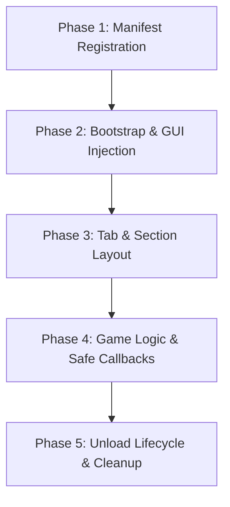

# GousseUI Library & Development Phases Guide

GousseUI is a lightweight, modern, dark-themed Luau UI Library engineered for Roblox execution environments and the Gousse Script Hub ecosystem.

---

## 1. Core Architecture & Theme System

GousseUI adopts an Obsidian / GitHub Dark aesthetic with high contrast and restrained accents:

| Token | RGB Value | Hex | Usage |
| :--- | :--- | :--- | :--- |
| `Background` | `15, 18, 24` | `#0f1218` | Outer window background |
| `Sidebar` | `19, 23, 31` | `#13171f` | Tab sidebar & sub-containers |
| `Surface` | `24, 29, 39` | `#181d27` | Element cards & inputs |
| `Border` | `38, 45, 60` | `#262d3c` | Standard structural borders |
| `Primary` | `56, 139, 253` | `#388bfd` | Active tabs, knobs, accent bars |
| `Success` | `46, 160, 67` | `#2ea043` | Positive toasts, friendly Chams |
| `Danger` | `248, 81, 73` | `#f85149` | Error toasts, enemy Chams |
| `TextPrimary`| `240, 246, 252` | `#f0f6fc` | Headings & primary labels |
| `TextSecondary`| `139, 148, 158` | `#8b949e`| Subtitles & body descriptions |

### Safe Parenting Invariant
To prevent game-level detection, all GUI instances must resolve parents using:
```luau
local function GetSafeGuiParent(): Instance
    if gethui then
        local ok, hui = pcall(gethui)
        if ok and hui then return hui end
    end
    local okCore, cg = pcall(function() return game:GetService("CoreGui") end)
    if okCore and cg then return cg end
    return game.Players.LocalPlayer:WaitForChild("PlayerGui")
end
```

---

## 2. API Reference Cheatsheet

### 2.1 Window Creation
```luau
local Window = GousseUI:CreateWindow({
    Title = "Gousse Hub",
    SubTitle = "Universal Edition",
    Keybind = Enum.KeyCode.RightControl, -- Default hotkey to hide/show
    Size = UDim2.new(0, 680, 0, 440)     -- Optional custom size
})
```
- **Methods**:
  - `Window:Toggle(state: boolean?)`: Toggle or set visibility.
  - `Window:Destroy()`: Completely cleans up the ScreenGui.
  - `Window:CreateTab({ Name: string, Icon: string? })`: Instantiates a new navigation tab.

### 2.2 Tab & Section Creation
```luau
local CombatTab = Window:CreateTab({ Name = "Combat", Icon = "🎯" })
CombatTab:CreateSection("Targeting")
```

### 2.3 Interactive Controls

#### Button
```luau
CombatTab:CreateButton({
    Name = "Trigger Teleport",
    Callback = function()
        print("Action triggered")
    end
})
```

#### Toggle
```luau
local HitboxToggle = CombatTab:CreateToggle({
    Name = "Expand Hitboxes",
    Default = false,
    Callback = function(enabled: boolean)
        print("Toggle state:", enabled)
    end
})
-- Methods: HitboxToggle.Set(true), HitboxToggle.Get()
```

#### Slider
```luau
local SpeedSlider = CombatTab:CreateSlider({
    Name = "WalkSpeed",
    Min = 16,
    Max = 250,
    Default = 16,
    Decimals = 0,
    Suffix = " studs/s",
    Callback = function(value: number)
        print("Slider value:", value)
    end
})
-- Methods: SpeedSlider.Set(50), SpeedSlider.Get()
```

#### Dropdown
```luau
local ModeDrop = CombatTab:CreateDropdown({
    Name = "Aim Mode",
    Options = { "Head", "Torso", "Random" },
    Default = "Head",
    Callback = function(selected: string)
        print("Selected:", selected)
    end
})
-- Methods: ModeDrop.Set("Torso"), ModeDrop.Get()
```

#### Input Field
```luau
local KeyInput = CombatTab:CreateInput({
    Name = "Webhook URL",
    Placeholder = "https://discord.com/api/...",
    Callback = function(text: string)
        print("Input:", text)
    end
})
-- Methods: KeyInput.Set("value"), KeyInput.Get()
```

#### Paragraph (Info Card)
```luau
CombatTab:CreateParagraph({
    Title = "Usage Instructions",
    Content = "Press RightControl to toggle the menu. Drag the titlebar to move."
})
```

### 2.4 In-Game Toast Notifications
```luau
GousseUI:Notify({
    Title = "Gousse Hub",
    Content = "Module initialized successfully!",
    Type = "success", -- "info" | "success" | "warning" | "error"
    Duration = 4
})
```

---

## 3. Development Phases (Fase Pengembangan)

When developing a new game script or extending an existing one, follow these 5 phases:



### Phase 1: Manifest Registration (`games.json`)
Register the target game under `games` using its Universe ID (`game.GameId`). Configure sub-places with Place IDs (`game.PlaceId`) if the game uses multi-world mechanics:
```json
"111958650": {
  "name": "Arsenal",
  "status": "public",
  "lead": "Jexytd",
  "entry": "games/arsenal/main.luau",
  "places": {}
}
```

### Phase 2: Bootstrap & Dependency Injection
Structure the entry script to accept `GousseUI` directly or resolve it from environment / fallback:
```luau
local passedUI = ...
local env = (getgenv and getgenv()) or _G or {}
local GousseUI = passedUI or env.GousseUI

if not GousseUI then
    local src = game:HttpGet("https://raw.githubusercontent.com/Jexytd/Gousse/main/library.luau")
    GousseUI = loadstring(src)()
end
```

### Phase 3: Tab & Section Layout
Create logical tabs aligned with player workflows:
- `Combat`: Weapons, hitboxes, silent aim, triggerbot.
- `Visuals`: ESP, chams, lighting, FOV, tracers.
- `Movement`: Speed, jump, fly, noclip, bunny hop.
- `Utility`: Server hop, rejoin, player teleport, anti-AFK.
- `Settings`: Unload button, hotkey reminders, credits.

### Phase 4: Game Logic & Safe Callbacks
- Wrap remote calls, character physics, and metatables inside `pcall`.
- Guard against missing characters with `LocalPlayer.CharacterAdded:Connect(...)`.
- Use event throttling (`RunService.RenderStepped` or `Stepped`) rather than busy `while true do` loops.

### Phase 5: Unload Lifecycle & Cleanup
Always provide an Unload button in the Settings tab to ensure a clean state:
```luau
SettingsTab:CreateButton({
    Name = "Unload Script",
    Callback = function()
        -- 1. Disconnect all RBXScriptConnections
        if noclipConn then noclipConn:Disconnect(); noclipConn = nil end
        if bHopConn then bHopConn:Disconnect(); bHopConn = nil end
        
        -- 2. Clean up visual highlights and drawing objects
        for _, hl in pairs(highlights) do hl:Destroy() end
        
        -- 3. Reset physics
        local hum = LocalPlayer.Character and LocalPlayer.Character:FindFirstChildOfClass("Humanoid")
        if hum then hum.WalkSpeed = 16 end
        
        -- 4. Destroy GUI
        Window:Destroy()
        GousseUI:Notify({ Title = "Gousse Hub", Content = "Unloaded cleanly.", Duration = 3 })
    end
})
```

---

## 4. Universal Loader (`Init.luau`) Pipeline

The Universal Loader provides a unified entry link:
1. **GousseUI Preloading**: Loads `library.luau` and exposes it via `getgenv().GousseUI`.
2. **Manifest Check**: Downloads `games.json` and evaluates `game.GameId`.
3. **Sub-Place Matching**: Checks `game.PlaceId` for world-specific scripts.
4. **Fallback Handler**: Routes to `games/universal.luau` if unlisted.
5. **Dual Fetching**: Tries local dev server (`http://localhost:3456`) when `Gousse_DevMode` is true, otherwise loads from GitHub Raw.
